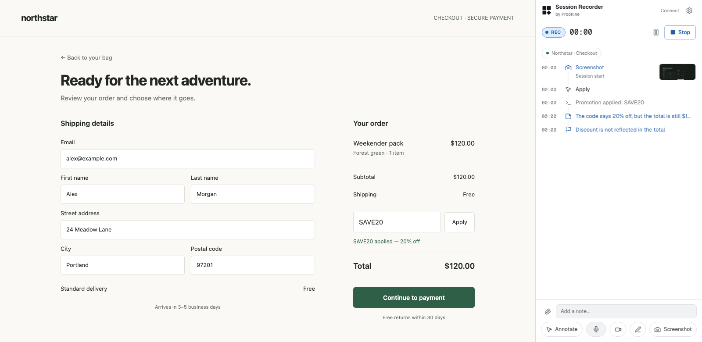

# Session Recorder by Proofline

Record a browser bug, point out what went wrong, and file a GitHub issue with the evidence attached.

Session Recorder is a **free, open-source Chrome extension** for QA and product teams. It captures browser activity while you reproduce a problem, keeps your annotations and narration with the recording, and turns the session into a report a developer or coding agent can use.

[Install from the Chrome Web Store](https://chromewebstore.google.com/detail/session-recorder/dboiheheijgmfpfhbmjggiijpgondghh) · [Sharing setup](docs/sharing.md) · [Privacy](docs/PRIVACY.md) · [Report a problem](https://github.com/prooflinedev/session-recorder-chrome-extension/issues)

## Record → annotate → file

1. Open the extension beside the app you want to test and select **Record**. The arrow next to it contains capture options, including microphone and video.
2. Reproduce the problem. Toggle **Annotate** to select a page element or drag a rectangle and add a comment. You can also mark up a screenshot, dictate into a comment, attach a file, or add a note.
3. Stop recording. A full-page report opens with the issue draft and evidence. Select **File issue** to generate a summary, publish the report, and create the GitHub issue using your configured services.

The arrow beside **File issue** selects a repository and remembers your last choice for new reports. Annotations and spoken notes lead the AI summary; console and network details support it. Filing shows progress and can be canceled.

Recording, annotation and ZIP export work without an account or API key. Configure publishing and GitHub access once to use one-click filing. AI is optional: you can edit the issue draft yourself.

<picture>
  <source media="(prefers-color-scheme: dark)" srcset="docs/screenshots/recording-dark.png" />
  
</picture>

## What a recording contains

- Clicks, inputs, navigation and tabs opened by the recorded app.
- Console messages, exceptions, network requests and responses.
- Screenshots, live page annotations and screenshot markup.
- Optional microphone narration, transcripts and tab video with sound.
- Uploaded or attached files, markers and notes.
- An optional OpenAPI description inferred from captured requests.

Capture settings control screenshot frequency, body-size limits and redaction. Chrome displays a debugger banner while deep capture is active. If it cannot attach, the report records that gap rather than claiming to have captured the missing network or console evidence.

## Choose your services

The extension supports your own accounts and API keys. **Settings → Services** chooses which service handles AI, report hosting and GitHub issue creation; the other settings pages hold the provider configuration.

| Feature | Personal setup |
| --- | --- |
| AI summaries and session titles | OpenAI, an OpenAI-compatible endpoint, Anthropic or Google |
| Voice transcription and annotation dictation | Deepgram, ElevenLabs or OpenAI-compatible transcription |
| Private report publishing | Your Cloudflare Pages project, protected by Cloudflare Access |
| GitHub issues | Repository-specific tokens; multiple repositories supported |

With a model configured, stopping a recording also generates its session-list title. Page vocabulary can help Deepgram and ElevenLabs recognize unusual terms during annotation dictation. Provider and hosting charges are separate from the free extension.

See [sharing setup](docs/sharing.md) for configuration and token permissions.

### Proofline connection — preview

The optional Proofline connection supports credit-funded AI, private reports and GitHub App issue filing. The backend and website are deployed. The connection remains in preview, and managed speech is disabled until its providers are configured.

**Settings → Proofline** connects your account and selects the paying workspace. **Settings → Services** explicitly enables managed services; connecting alone keeps your personal-key choices. The existing 10,000-credit grant requires Proofline onboarding and GitHub App installation. AI pauses when credits run out and never silently switches to your keys.

Hosted reports are private to their creator and selected readers. Outside readers need a free Proofline account. Local recording and personal-key integrations remain available independently.

## Use a report with a coding agent

Export a ZIP, unzip it, and give `report.md` to Claude Code, Codex, Cursor, ChatGPT, or another coding agent. Include the extracted folder when the agent can read screenshots and other attachments.

Choose Full, Standard, Compact or Minimal when exporting. The estimate helps you fit the report into a model's context; trimming is deterministic and does not call an LLM. You can export the same local session at another level later.

[Report format and suggested prompt](docs/report-format.md)

## Privacy

Recordings stay in Chrome's local storage by default. Redaction masks common credentials and sensitive fields during capture, but it cannot remove every secret from screenshots, audio, files or arbitrary text.

Transcription and AI send the relevant audio or text to the service you select. Publishing uploads the report and its included attachments. A private report link does not make the text of a public GitHub issue private. Deleting a local recording does not delete a published report.

[Read the privacy policy](docs/PRIVACY.md) for the data each optional service receives.

## Development and documentation

[Build, load and test from source](DEVELOPMENT.md) · [Documentation index](docs/README.md)

The source lives at [prooflinedev/session-recorder-chrome-extension](https://github.com/prooflinedev/session-recorder-chrome-extension). The Chrome Web Store listing retains its existing installation ID during the Proofline migration.

## License

[GNU Affero General Public License v3.0](LICENSE) (`AGPL-3.0-only`). Copyright © 2026 Mohsen Azimi.
