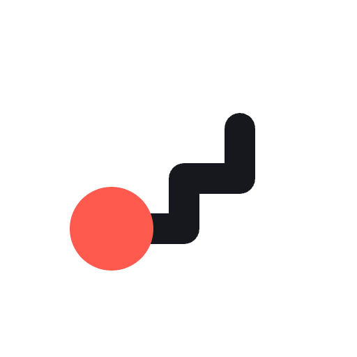
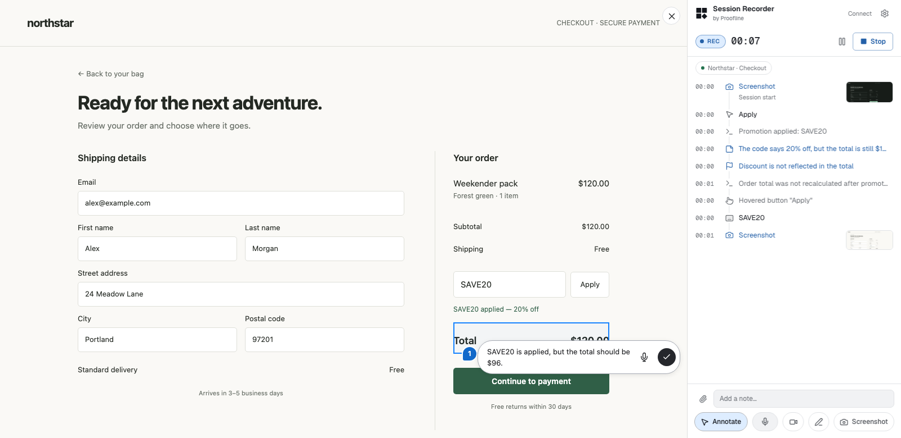
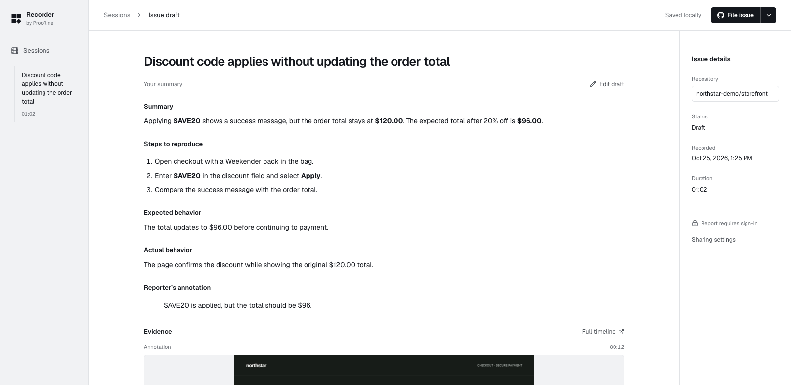

<p align="center">
  
</p>

<h1 align="center">Session Recorder</h1>

<p align="center">
  Record a bug. Hand your AI agent the whole story.
</p>

<p align="center">
  <a href="https://chromewebstore.google.com/detail/session-recorder/dboiheheijgmfpfhbmjggiijpgondghh">
    
  </a>
</p>

**Session Recorder by Proofline is a free, open-source, local-first Chrome extension for
recording web bugs for AI coding agents.** It captures clicks, console errors,
network requests and responses, screenshots, video, voice narration, DOM
interactions, annotations, and uploaded files, then exports an LLM-ready
Markdown report for Claude Code, Codex, Cursor, ChatGPT, and other coding
agents.

Reproducing a bug for an AI coding agent means describing a hundred little
things: what you clicked, what the app requested, the error in the console, what
you expected. Session Recorder captures all of it while you use your app, then
exports one clean report your agent can read.

Website: [azimi.me/session-recorder-chrome-extension](https://proofline.sh/session-recorder-chrome-extension/)
· [Example report](https://proofline.sh/session-recorder-chrome-extension/example-report/)
· [Claude Code](https://proofline.sh/session-recorder-chrome-extension/claude-code/)
· [Cursor](https://proofline.sh/session-recorder-chrome-extension/cursor/)
· [Codex](https://proofline.sh/session-recorder-chrome-extension/codex/)
· [ChatGPT](https://proofline.sh/session-recorder-chrome-extension/chatgpt/)

<p align="center">
  <picture>
    <source media="(prefers-color-scheme: dark)" srcset="docs/screenshots/recording-dark.png" />
    
  </picture>
</p>

## What you get

- one timeline of everything that happened, in order: clicks, typing, text
  selections, page changes, network requests and their responses, console
  errors, and screenshots
- your own voice, transcribed in real time and slotted in next to what you were
  doing, so the report reads like you walking the agent through it
- video of the tab, with its sound, that pauses and resumes with the session
  and plays inline in the report
- arrows and boxes you draw right on the page, saved into the report as an image
- sessions that follow you: when the app opens a new tab, recording continues
  there and comes back when the tab closes
- an OpenAPI spec compiled from the requests your app made, when you turn it on
- a report sized to fit your model, with a live token estimate for each level
- secrets hidden by default and recordings stored locally, with optional sharing
- protected Cloudflare Pages reports and editable AI summaries for GitHub issues

### Dial in how much you capture

The arrow next to Record opens capture options: a detail slider that sets
screenshot frequency, pointer tracking, and how much of each request body to
keep, plus switches to start video, mic narration, and the API spec.

### Point at the problem

Freeze the screen and mark it up. The annotated image goes straight into the
report, so your agent sees the exact thing you meant.

<p align="center">
  <picture>
    <source media="(prefers-color-scheme: dark)" srcset="docs/screenshots/annotate-dark.png" />
    
  </picture>
</p>

### Right-sized for any model

Long sessions get big. Pick a level and see the estimated token count before you
export. The same recording can be re-exported at any level later. Your explicit
signals (voice, annotations, notes, and errors) are never trimmed.

<p align="center">
  <picture>
    <source media="(prefers-color-scheme: dark)" srcset="docs/screenshots/report-dark.png" />
    
  </picture>
</p>

### Secrets stay secret

Passwords, auth headers, and tokens are masked before anything is saved. You can
add your own rules or turn masking off per session in the settings.

## Install

### Chrome Web Store

[Add Session Recorder to Chrome](https://chromewebstore.google.com/detail/session-recorder/dboiheheijgmfpfhbmjggiijpgondghh) —
click the toolbar icon to open the side panel, then click Record.

> While recording, Chrome shows a "... is being debugged" banner. That is how
> the extension taps the network and console streams. If the debugger cannot
> attach, the session still records interactions, navigation, voice,
> annotations, and files, and the report notes the gap.

### From source

```bash
pnpm install
pnpm build            # -> .output/chrome-mv3
```

In Chrome, open `chrome://extensions`, enable Developer mode, click Load
unpacked, and select `.output/chrome-mv3`. Click the toolbar icon to open the
side panel, then click Record.

## Develop and test

```bash
pnpm dev              # WXT dev server with HMR
pnpm compile          # typecheck
pnpm test             # unit and integration tests (vitest)
pnpm test:e2e         # Playwright end-to-end (add :headed for a visible browser)
```

The end-to-end suite in [`e2e/`](./e2e) loads the built extension into
Chromium, records a session against the bundled [`demo/`](./demo) page, exports
through the real side-panel UI, and checks the zip: the report contains the
actions and marker, and a typed password appears nowhere in the output.

## Voice narration and transcription (optional)

Talk while you record to explain what's happening. With Deepgram (Nova-3) or ElevenLabs (Scribe v2 Realtime)
configured, the extension transcribes in real time over a streaming websocket.
Each utterance lands on the timeline stamped at the moment you began speaking,
so the report reads: narration "while clicking 'Checkout'". OpenAI
(gpt-4o-transcribe) transcribes in batches instead.

Set the provider, model, and API key on the options page. The key stays in
`chrome.storage.local`. Without a key, sessions keep the raw audio.

An open annotation comment receives speech from the active recording mic. Its mic
button turns dictation on or off. With an AI model configured, visible page labels
provide a small vocabulary of unusual terms for Deepgram or ElevenLabs. Provider
charges apply, including ElevenLabs keyterm prompting charges.

## Share a report as a GitHub issue (optional)

Choose **Share report & create issue** on a stopped session. Configure your own
Cloudflare API token, Direct Upload Pages project and Access login policy, then
publish a report behind Cloudflare Access. The settings include a preconfigured
token-creation link. Generate an editable summary with your own OpenAI,
OpenAI-compatible, Anthropic or Google API key, or write it yourself. Open GitHub
with the summary and protected report link, then submit the issue there.

See [Sharing setup](docs/sharing.md) for token permissions, login configuration,
provider setup, upload limits and deleting published reports. Recording and ZIP
export still work without these integrations.

## Using a report with an LLM agent

Unzip the export and give `report.md` to your coding agent. It is a
chronological narrative with `[mm:ss]` timestamps joining interactions, network
summaries, errors, narration, and annotations. At L2 and L3 it stands alone
without the asset files. See [`docs/report-format.md`](./docs/report-format.md)
for a suggested prompt.

Step-by-step workflows, with a copy-pasteable prompt for each:

- [Claude Code](https://proofline.sh/session-recorder-chrome-extension/claude-code/) — unzip into the repo and point it at `report.md`
- [Cursor](https://proofline.sh/session-recorder-chrome-extension/cursor/) — attach with `@report.md`, plus a reusable project rule
- [Codex](https://proofline.sh/session-recorder-chrome-extension/codex/) — local CLI and cloud tasks, plus an `AGENTS.md` snippet
- [ChatGPT](https://proofline.sh/session-recorder-chrome-extension/chatgpt/) — upload one self-contained file

Or copy the [Markdown browser bug report template](https://proofline.sh/session-recorder-chrome-extension/bug-report-template/).

Or read [a complete example report](https://proofline.sh/session-recorder-chrome-extension/example-report/)
and [what AI coding agents actually need from a bug report](https://proofline.sh/session-recorder-chrome-extension/ai-bug-report/).

## Why we need each permission

- `debugger`: network, console, and exception capture through CDP
- `sidePanel`: the recording and export UI
- `tabs` and `webNavigation`: multi-tab tracking and navigation events
- `scripting`: content-script activation
- `storage` and `unlimitedStorage`: sessions live in IndexedDB
- `offscreen`: `MediaRecorder` for voice and video
- `tabCapture`: video recording of the tab
- `downloads`: save the exported zip
- `alarms`: flush the event buffer while recording
- `<all_urls>`: record whatever app you point it at

## Under the hood

For contributors: the extension captures network and console through
`chrome.debugger`, navigation through `chrome.webNavigation`, and interactions
through content scripts. Voice and tab video record in an offscreen document;
screenshots come from the debugger. Everything flows through one funnel in the
background service worker into IndexedDB, and trimming at export is
deterministic (no LLM). The full design is in [`PLAN.md`](./PLAN.md) and
[`IMPLEMENTATION.md`](./IMPLEMENTATION.md).

## Project layout

```
entrypoints/         background (orchestrator), 3 content scripts,
                     sidepanel + options (React), offscreen + mic-permission
lib/session/         frozen contract: types, event registry, settings, messaging
lib/capture/         debugger, network, console, screenshots, multitab, redaction
lib/export/          trimmer, markdown renderer, shape-summary, tokens, zip, bundle
lib/transcription/   provider interface + OpenAI-compatible / Deepgram / ElevenLabs
lib/storage/         IndexedDB layer + batched event writer
e2e/                 Playwright end-to-end suite
demo/                local test page that exercises every capture path
```

## Not in v1

Firefox and Safari ports, and DOM snapshot replay. See [`PLAN.md`](./PLAN.md) §11.

## License

Session Recorder is free software under the
[GNU Affero General Public License v3.0](./LICENSE).

You may use it, modify it, and redistribute it. If you distribute a modified
version — or run one as a network service — you must release your full source
under the same license. In practice that means nobody can take this, close the
source, and sell it as their own product.

Copyright © 2026 Mohsen Azimi.

### Optional Proofline connection

Settings → Proofline connects the extension through browser approval. Explicitly enable Proofline credits for summaries, session titles, page vocabulary and transcription; choose a paying workspace, private hosted reports and GitHub App issue filing. The existing 10,000-credit grant requires onboarding and GitHub App installation. Local capture, exports, personal API keys and Cloudflare publishing remain available. See [sharing setup](docs/sharing.md) and the [privacy policy](docs/PRIVACY.md).
